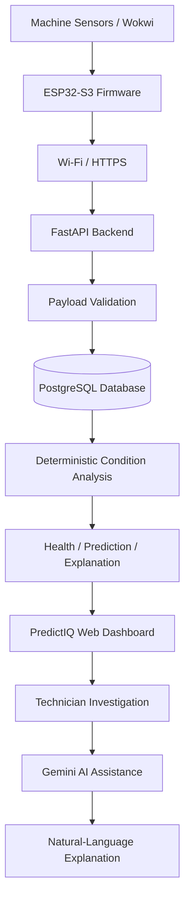

# PredictIQ
## Evidence-Grounded Intelligence for Predictive Maintenance

> **Machines generate signals. PredictIQ turns those signals into evidence technicians can understand and act on.**

PredictIQ is an IoT-based predictive-maintenance platform designed to connect machine telemetry, deterministic condition analysis, and AI-assisted investigation in one workflow.

It helps technicians monitor machine behaviour, identify abnormal operating conditions, understand the factors contributing to machine-health changes, and investigate potential maintenance requirements.

By combining an ESP32-S3-based telemetry system, a FastAPI backend, PostgreSQL persistence, a web dashboard, and Google's Gemini AI, PredictIQ aims to bridge the gap between raw industrial sensor data and understandable maintenance decisions.

**The core principle:** machine measurements and engineering logic establish the evidence. Gemini helps users interact with and understand that evidence.

---

## Project links

| Resource | Link |
|---|---|
| GitHub repository | [PredictIQ — Source Code](https://github.com/kit29-25bad132/PredictIQ.git) |
| Live application | [Open PredictIQ](https://predictiq-neon.vercel.app/) |
| Demo video | [Watch PredictIQ Demo](https://www.youtube.com/watch?v=U7BK0XuoIL8&t=2s) |
| Developer | Rishi V |

---

## The problem

Industrial machines rarely fail without warning. Their operating conditions can change gradually before a failure occurs.

Examples include:

- Increasing operating temperature.
- Abnormal vibration patterns.
- Changes in electrical current.
- Unstable rotational speed.
- Repeated alerts and unexplained machine-health changes.

The challenge is not simply collecting sensor values. It is converting those readings into useful, understandable, and traceable maintenance information.

Traditional monitoring workflows can leave technicians with fragmented information:

- Sensor dashboards show readings without sufficient context.
- Alerts identify abnormal conditions but may not explain contributing factors.
- Historical machine information can be difficult to connect with current readings.
- Technicians must manually interpret multiple signals.
- AI-generated explanations can be misleading when they are not grounded in actual machine data.

PredictIQ addresses this problem by connecting telemetry ingestion, machine-condition analysis, persistent records, explanations, and technician-facing interaction.

## Our approach

PredictIQ follows a structured workflow:

**Sense → Validate → Store → Analyse → Explain → Investigate → Act**

### 1. Machine telemetry

The system is designed to receive machine readings through an ESP32-S3 device or Wokwi simulation.

The telemetry workflow includes machine parameters such as:

- Temperature
- Vibration
- Current
- RPM

### 2. Deterministic condition analysis

The backend evaluates available machine readings using implemented condition-analysis and rule-based logic.

This is the foundation for machine-health outputs. It keeps the core analysis traceable to the input data and implemented rules.

### 3. Persistent data

PostgreSQL provides persistent storage for telemetry and application records, supporting retrieval and historical investigation.

### 4. Gemini-assisted interaction

Google Gemini is used as the AI model for natural-language assistance within the PredictIQ direction.

Its role is to help users understand available machine context and analysis. It should not replace the deterministic analysis engine or invent sensor measurements.

### 5. Technician decision support

The web application brings machine information and analysis into a single interface so technicians can investigate abnormal behaviour and make informed maintenance decisions.

---

## System architecture

### End-to-end workflow



The architecture separates machine-data processing from AI-assisted interaction.

| Component | Technology | Responsibility |
|---|---|---|
| Device layer | ESP32-S3 | Machine telemetry acquisition and transmission |
| Simulation | Wokwi | Hardware and sensor workflow simulation |
| Communication | Wi-Fi / HTTPS | Device-to-backend communication |
| Backend | Python / FastAPI | API services, validation, and application logic |
| Database | PostgreSQL | Persistent telemetry and application records |
| Analysis | Deterministic rule-based engine | Machine-condition evaluation |
| AI assistance | Google Gemini | Natural-language assistance |
| Frontend | Web application | Machine monitoring and technician interaction |
| Frontend hosting | Vercel | Public web application |

A successful Wi-Fi connection alone does not prove that telemetry has reached the backend. The complete ingestion path must be verified through API responses and persisted records.

---

## Core capabilities

PredictIQ's V1 architecture covers the following capabilities:

| Capability | Description |
|---|---|
| IoT telemetry ingestion | Receives machine readings from the device/simulator |
| Device communication | Sends telemetry through Wi-Fi and HTTPS |
| Payload validation | Validates incoming telemetry |
| PostgreSQL persistence | Stores machine and application records |
| Machine health assessment | Evaluates machine condition from available signals |
| Prototype prediction | Produces deterministic, rule-based prediction outputs |
| Explainability | Identifies contributing machine-condition factors |
| Alert management | Supports abnormal-condition alert workflows |
| Maintenance management | Supports maintenance records and related workflows |
| Technician feedback | Supports recording observations and outcomes |
| Web dashboard | Provides a centralized monitoring interface |
| Gemini assistance | Provides the AI model layer for natural-language assistance |

The actual availability of each capability depends on the deployed backend, configuration, and submitted application version.

---

## Machine-condition analysis

PredictIQ uses deterministic, rule-based analysis for its prototype machine-health and prediction workflows.

The purpose is to evaluate available machine signals and identify conditions that may require attention.

### Example operating scenarios

| Scenario | Machine behaviour | Intended system response |
|---|---|---|
| Normal | Operating readings within expected conditions | Normal condition |
| Degradation | One or more abnormal readings | Warning condition and contributing-factor analysis |
| Critical | Multiple severe abnormal conditions | Critical condition and alert workflow |
| Insufficient data | Missing or invalid readings | Validation or insufficient-evidence handling |

The actual thresholds and outcomes depend on the implemented engineering rules.

### Prediction limitations

PredictIQ's prototype prediction workflow is deterministic and rule-based.

It should not be interpreted as a scientifically validated failure-prognosis model.

The project does not claim validated Remaining Useful Life (RUL), scientifically established failure probabilities, or validated statistical confidence scores.

Real industrial deployment requires machine-specific baselines, calibrated sensors, labelled operating data, and validation against actual maintenance outcomes.

---

## Gemini AI assistance

PredictIQ uses **Google Gemini** as its AI model for natural-language assistance.

The purpose of the AI layer is to make machine information easier to investigate and understand.

The intended interaction model connects AI assistance with the machine context available through the application.

### Design principles

- Machine measurements must originate from telemetry or persisted application records.
- Deterministic analysis must remain separate from generated explanations.
- AI-generated interpretation must not be presented as a measured sensor value.
- Missing or insufficient information should be acknowledged.
- AI responses must not silently modify authoritative machine-health results.
- AI assistance must not directly control machinery or bypass safety mechanisms.

Gemini is an assistance layer, not the source of truth for machine measurements.

---

## Data and trust boundaries

| Layer | Responsibility | Trust principle |
|---|---|---|
| Sensors / simulator | Generate machine readings | Preserve reading origin |
| ESP32-S3 | Package and transmit telemetry | Transmission must be verified |
| FastAPI | Validate and process requests | Reject invalid payloads |
| PostgreSQL | Persist application records | Preserve data traceability |
| Analysis engine | Evaluate machine condition | Keep outputs reproducible |
| Gemini | Assist with interpretation | Do not invent machine evidence |
| Frontend | Present information | Distinguish measured and generated information |

---

## Hardware and simulation

PredictIQ's device architecture uses the ESP32-S3.

The Wokwi simulation design includes the following sensor and signal components:

| Component | Purpose |
|---|---|
| ESP32-S3 | Main microcontroller |
| DS18B20 | Temperature measurement |
| MPU6050 | Vibration-related measurements |
| ADC input | Current-signal acquisition |
| Clock / pulse generator | RPM signal simulation |

The firmware workflow also includes Wi-Fi communication, HTTPS transmission, time synchronisation, and device-ingestion authentication.

Wokwi is useful for developing and testing the telemetry workflow before relying on physical hardware.

**Important:** a successful simulation is not equivalent to long-duration testing on industrial equipment.

---

## Deployment

The public PredictIQ frontend is available through Vercel.

**Live application:** https://predictiq-neon.vercel.app/

The application architecture uses a FastAPI backend and PostgreSQL database. The public frontend URL alone does not establish that every backend service and hardware-to-cloud workflow is operational.

### Production verification

A complete production verification should establish that:

- The frontend communicates with the intended backend.
- The backend connects to the intended PostgreSQL database.
- Database migrations are applied successfully.
- Device telemetry reaches the backend.
- Incoming telemetry is persisted.
- The same records can be retrieved through the API.
- The dashboard displays backend-backed information.
- The application continues operating independently of the developer's laptop.

### End-to-end target workflow

```text
ESP32-S3 / Wokwi
       |
       v
    Wi-Fi
       |
       v
  FastAPI Backend
       |
       v
  PostgreSQL
       |
       v
Condition Analysis
       |
       v
 Health / Alerts
       |
       v
 Web Dashboard
       |
       v
 Gemini Assistance
```

---

## Technology stack

| Layer | Technology |
|---|---|
| Embedded hardware | ESP32-S3 |
| Hardware simulation | Wokwi |
| Backend language | Python |
| Backend framework | FastAPI |
| Database | PostgreSQL |
| Frontend hosting | Vercel |
| AI model | Google Gemini |
| Communication | Wi-Fi / HTTPS |
| Version control | Git / GitHub |

Exact dependency versions are defined by the repository's committed dependency manifests.

---

## Local development

### Prerequisites

- Git
- Python
- Node.js
- PostgreSQL
- Optional: Docker
- Optional: Wokwi

### Clone the repository

```bash
git clone https://github.com/kit29-25bad132/PredictIQ.git
cd PredictIQ
```

### Backend setup

Create a Python virtual environment.

**Windows PowerShell**

```powershell
py -m venv .venv
.\.venv\Scripts\Activate.ps1
```

**macOS / Linux**

```bash
python3 -m venv .venv
source .venv/bin/activate
```

Install backend dependencies using the dependency manifest included in the repository.

Configure the environment variables required by the backend, including the database connection and any required service credentials.

### Database setup

Start PostgreSQL and configure the database connection.

If Alembic migrations are included in the repository, apply them using:

```bash
alembic upgrade head
```

### Frontend setup

Navigate to the frontend directory and install dependencies using the package manager and lockfile included in the repository.

Use the development script declared in the frontend's `package.json`.

### Device setup

Configure the ESP32-S3 or Wokwi firmware with the appropriate backend endpoint and device-ingestion credentials.

Verify the complete telemetry path rather than relying only on a successful Wi-Fi connection.

---

## Security and configuration

Credentials must be stored in server-side environment variables and must never be committed to the public repository.

Important configuration responsibilities include:

| Configuration | Purpose |
|---|---|
| Backend database URL | PostgreSQL connection |
| Backend application secrets | Secure application configuration |
| Device credentials | Restrict telemetry ingestion |
| Gemini API key | Authenticate AI model requests |
| Frontend API URL | Connect the web application to the backend |
| CORS configuration | Restrict permitted frontend origins |

Never expose database passwords, device credentials, or Gemini API keys in frontend code or public source files.

For production hardware, individual revocable device credentials are preferable to a shared fleet-wide secret.

---

## Testing and verification

PredictIQ should be evaluated through observable system behaviour.

### Machine-condition verification

- [ ] Normal operating readings produce the expected condition.
- [ ] Abnormal readings change the condition assessment.
- [ ] Critical readings trigger the expected alert workflow.
- [ ] Invalid payloads are rejected.
- [ ] Insufficient data is handled appropriately.
- [ ] Prediction outputs remain traceable to their inputs and rules.

### End-to-end verification

- [ ] ESP32-S3 or Wokwi generates telemetry.
- [ ] Telemetry reaches FastAPI.
- [ ] Backend validates the payload.
- [ ] PostgreSQL stores the corresponding record.
- [ ] The record can be retrieved through the API.
- [ ] The dashboard displays the corresponding data.
- [ ] Machine-condition analysis responds to changed readings.
- [ ] Alerts and explanations correspond to the analysed condition.
- [ ] Gemini assistance uses the available machine context where configured.

### Historical audit context

An earlier project audit recorded 139 automated tests passing and identified the main remaining work as runtime verification, including the complete device-to-API-to-database round trip, Docker execution, cloud deployment, and physical hardware testing.

Those results are historical and should not be treated as current test results without rerunning the checks against the current repository version.

---

## Responsible AI and safety

PredictIQ is designed for industrial decision support.

Incorrect or overconfident AI output can lead to unnecessary maintenance or unsafe decisions. The system therefore separates measured machine evidence from generated interpretation.

Its operating principles are:

1. Preserve sensor readings and their source.
2. Label simulated data as simulated.
3. Keep deterministic analysis distinguishable from AI-generated text.
4. Avoid presenting generated interpretations as verified diagnoses.
5. Disclose missing or insufficient evidence.
6. Avoid fabricated failure times, RUL, and confidence values.
7. Never allow AI assistance to bypass machine safety mechanisms.
8. Keep qualified technicians responsible for maintenance decisions.

PredictIQ is not a certified safety system or an autonomous machine controller.

---

## Limitations

- Wokwi simulation does not establish industrial-grade hardware reliability.
- Rule-based prototype predictions are not equivalent to validated failure-prognosis models.
- Real-world performance depends on sensor calibration and machine-specific operating conditions.
- AI-generated explanations can be incorrect and must be checked against available evidence.
- Physical-device connectivity must be validated independently of simulation.
- Cloud deployment must be verified through complete backend and database workflows.

---

## Roadmap

### Strengthen real-world validation

- Validate telemetry using physical ESP32-S3 hardware.
- Test with calibrated sensors and real machine operating data.
- Evaluate condition-analysis rules against labelled scenarios.
- Improve device identity and credential management.
- Measure backend reliability and telemetry latency.
- Evaluate Gemini responses for grounding and correctness.
- Validate the workflow with maintenance technicians.

### Expand predictive intelligence

- Improve machine-specific operating baselines.
- Collect labelled maintenance and failure data.
- Evaluate predictive models against real operating histories.
- Improve historical trend analysis.
- Expand fleet-level monitoring and maintenance analytics.

---

## Developer

**Rishi V**

PredictIQ is developed as an IoT predictive-maintenance project focused on connecting physical machine telemetry, explainable condition analysis, and AI-assisted investigation.

## Repository

[https://github.com/kit29-25bad132/PredictIQ](https://github.com/kit29-25bad132/PredictIQ)

## Live application

[https://predictiq-neon.vercel.app/](https://predictiq-neon.vercel.app/)

## Demo

[Watch the PredictIQ demonstration](https://www.youtube.com/watch?v=U7BK0XuoIL8&t=2s)

---

<p align="center">
  <strong>PredictIQ</strong><br/>
  <em>From machine signals to evidence-grounded decisions.</em><br/>
  <sub>Understand the machine. Trust the evidence. Improve maintenance decisions.</sub>
</p>
