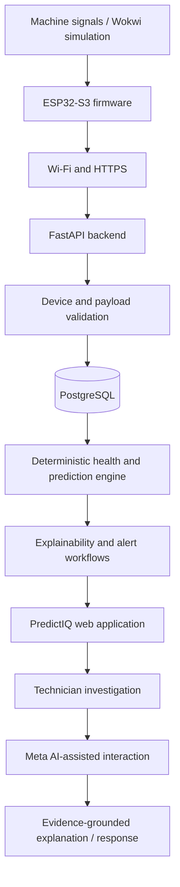

# PredictIQ
## Evidence-Grounded Multimodal Intelligence for Predictive Maintenance

> **Machines generate signals. PredictIQ turns those signals into evidence technicians can understand and act on.**

PredictIQ is an IoT predictive-maintenance system that connects machine telemetry, deterministic condition analysis, and Meta AI-powered interaction to help technicians investigate abnormal machine behaviour.

Built for the **Meta Global AI Developer Hackathon — Push the Frontier | Indie Developer Track**, PredictIQ explores a practical frontier: bringing multimodal AI into a physical-system workflow without allowing a language model to invent sensor readings, replace engineering logic, or make unverified maintenance decisions.

**The central idea:** deterministic systems establish what the machine data says; Meta AI helps people investigate, interpret, and interact with that evidence.

---

## At a glance

| | |
|---|---|
| Project | PredictIQ |
| Hackathon | Meta Global AI Developer Hackathon |
| Track | Indie Developer |
| Problem statement | Push the Frontier |
| Domain | Manufacturing, industrial IoT, predictive maintenance |
| Core workflow | Sense → Validate → Analyse → Explain → Investigate → Act |
| Primary system | ESP32-S3 / Wokwi, FastAPI, PostgreSQL, web dashboard |
| Meta AI role | Evidence-grounded multimodal interaction and technician assistance |
| Repository | **[ADD PUBLIC GITHUB URL]** |
| Demo | **[ADD 3-MINUTE DEMO VIDEO URL]** |
| Live application | **[ADD DEPLOYED APPLICATION URL, IF AVAILABLE]** |
| Developer | **[ADD YOUR NAME / HANDLE]** |

> Replace every `[ADD ...]` field before submitting. Remove any feature from the implemented list if it is not working in the submitted commit.

---

## The problem

Industrial machines rarely fail without warning. Their operating behaviour changes over time: temperature may rise, vibration may become abnormal, current draw may shift, or rotational speed may become unstable.

The challenge is not simply collecting sensor values. It is connecting those values to an understandable, verifiable maintenance decision.

In many small-scale monitoring workflows, the information a technician needs is fragmented:

- Sensor readings show *what* happened, but not always *why it matters*.
- Alerts identify abnormal conditions, but may not provide enough context to investigate.
- Maintenance history and current telemetry may be disconnected.
- Technicians must interpret dashboards, logs, and machine context under time pressure.
- A conversational AI interface can sound confident even when the underlying data is incomplete.

PredictIQ addresses this gap by connecting machine telemetry to an evidence-based analysis workflow, then using AI as an interface for understanding and investigation—not as an unchecked source of machine truth.

## Our approach

PredictIQ combines two complementary layers:

### 1. Deterministic machine intelligence

The core system receives telemetry and evaluates machine condition using implemented, inspectable analysis logic. It supports health assessment, predictions, contributing-factor explanations, alerts, and maintenance context.

This layer is responsible for the application's computed machine-health outputs. It must remain traceable to the data and rules that produced them.

### 2. Meta AI-assisted investigation

The hackathon direction adds a natural, multimodal way to interact with machine evidence. Meta models can help a technician ask questions, interpret available context, inspect visual information, or communicate findings.

The AI layer is deliberately constrained:

- It receives machine context and analysis outputs from the application.
- It must distinguish measured data from generated interpretation.
- It must not invent sensor readings, timestamps, faults, or maintenance events.
- It must not silently overwrite deterministic health assessments.
- Its recommendations are advisory and should expose uncertainty and missing evidence.

**This separation is the design principle that makes PredictIQ useful beyond a chatbot attached to a dashboard.**

---

## What makes PredictIQ different

| Typical monitoring experience | PredictIQ's intended experience |
|---|---|
| Read individual sensor values | Investigate machine condition across related signals |
| Receive an alert | Inspect the evidence contributing to an alert |
| Navigate multiple screens | Ask questions about machine state in natural language |
| Treat AI output as an answer | Ground AI responses in telemetry and deterministic analysis |
| Treat generated text as a diagnosis | Keep measured facts, computed results, and AI interpretation distinct |
| Demonstrate a simulated dashboard | Trace telemetry through ingestion, persistence, analysis, and presentation |

PredictIQ is a decision-support prototype. It is not a certified safety system, an autonomous machine controller, or a substitute for qualified maintenance personnel and manufacturer procedures.

---

## System architecture

### End-to-end data path



The diagram describes the intended product workflow. The exact deployed path and every integration must be verified against the submitted code and demo. A separate gateway is not assumed: the documented V1 architecture sends device telemetry to FastAPI. Add a gateway to this diagram only if a distinct gateway service is present and used in the final implementation.

### Data and trust boundaries

| Layer | Responsibility | Trust rule |
|---|---|---|
| Sensors / simulator | Produce machine readings | Preserve the source of each reading |
| ESP32-S3 | Package and transmit telemetry | Do not treat Wi-Fi connection as proof of ingestion |
| FastAPI | Validate, authenticate, and expose application APIs | Reject invalid payloads and unauthorised device requests |
| PostgreSQL | Persist telemetry and application records | Stored values must be traceable to accepted requests |
| Deterministic engine | Compute condition and analysis outputs | Keep results reproducible and explainable |
| Meta AI layer | Help users interpret and investigate evidence | Never fabricate or become the authority for measured facts |
| Frontend | Present machine state and interaction | Display backend data, not fabricated live values |

---

## Core product capabilities

The following describes the PredictIQ product scope. Only mark a capability as complete in the submission if it is present and demonstrable in the submitted version.

| Capability | What it does | Evidence to show |
|---|---|---|
| Telemetry ingestion | Receives machine readings from the device/simulator | Request, API response, persisted record |
| Device authentication | Restricts telemetry ingestion to authorised devices, if enabled | Valid and invalid credential tests |
| Persistent data | Stores telemetry and operational records | Database record and API retrieval |
| Machine health | Evaluates machine condition from available signals | Normal, warning, and critical scenarios |
| Prediction workflow | Produces rule-based/prototype prediction outputs | Persisted prediction and its prototype limitations |
| Explainability | Exposes contributing sensor factors | Explanation shown beside the result |
| Alerts | Creates and manages abnormal-condition alerts | Alert creation, acknowledgement, resolution |
| Maintenance workflow | Records maintenance activity and outcomes | Linked maintenance record |
| Technician feedback | Captures observations and ground truth | Saved feedback linked to relevant records |
| Web dashboard | Presents machine and maintenance context | Live API-backed user journey |

### Important limitation disclosure

The existing V1 checklist describes the prediction system as deterministic / physics-rule based and explicitly prototype-level. It does **not** claim Remaining Useful Life (RUL) or a validated confidence score. PredictIQ must not present either as a scientifically validated output unless that capability has been separately implemented and validated.

Simulation data is not industrial field data. A Wokwi demonstration proves a simulated integration path, not reliability on a deployed industrial machine.

---

## Meta AI integration — hackathon contribution

**This section is the most important part of the hackathon submission.** The hackathon guide requires the demo to highlight only the specific features, code, and functionality built during the event, and requires those contributions to be clearly identifiable. The pre-existing PredictIQ platform must not be misrepresented as hackathon work.

### Meta model usage

The hackathon guide identifies the Meta model family and Meta Model API as the supported route for model integration, including Muse Spark, Muse Wonder, Muse Image, Muse Voice Transcribe, and SAM 3.1. Use only the models actually integrated into this project.

Complete this table accurately:

| Meta model / service | How PredictIQ uses it | Implementation status | Evidence |
|---|---|---|---|
| **[Exact Meta model name]** | **[Specific task performed using machine context]** | **[Implemented / In progress / Not implemented]** | **[Code path, API call, or demo timestamp]** |
| **[Exact Meta model name, if applicable]** | **[Specific task]** | **[Status]** | **[Evidence]** |
| **[Exact Meta model name, if applicable]** | **[Specific task]** | **[Status]** | **[Evidence]** |

Do not list a model merely because it was evaluated, considered, or planned. A model belongs in this table as an implemented integration only when the submitted code actually calls it and the result can be demonstrated.

### Intended interaction patterns

The following are potential directions for the Meta AI layer. Retain only those implemented in the final submission.

#### Evidence-grounded machine investigation

A technician asks a question about a machine. The application retrieves relevant machine context—such as recent telemetry, health status, alerts, and deterministic explanations—and passes that context to the Meta model.

The response should:
- Refer to the supplied machine and time window.
- Distinguish sensor measurements from analysis and model interpretation.
- Explain which evidence supports the response.
- State when required data is missing or insufficient.
- Avoid inventing faults, readings, causes, or certainty.

**Implementation status:** `[UPDATE: IMPLEMENTED / IN PROGRESS / NOT IMPLEMENTED]`

**Evidence:** `[ADD SOURCE FILE / API ROUTE / DEMO TIMESTAMP]`

#### Voice-first technician interaction

If Muse Voice Transcribe is integrated, it can convert a technician's spoken request into text for the investigation workflow. Transcription is not acoustic fault diagnosis: speech transcription alone does not establish a machine fault from sound.

**Implementation status:** `[UPDATE STATUS OR REMOVE THIS SECTION]`

**Evidence:** `[ADD SOURCE FILE / DEMO TIMESTAMP]`

#### Visual machine inspection

If SAM 3.1 or another Meta vision model is integrated, describe the exact image task it performs, the input supplied, and how the result is used. Segmentation identifies or separates visual regions; it does not independently prove that a component is defective or predict machine failure.

**Implementation status:** `[UPDATE STATUS OR REMOVE THIS SECTION]`

**Evidence:** `[ADD SOURCE FILE / DEMO TIMESTAMP]`

#### Maintenance history investigation

If the Meta AI layer can query and summarise persisted alert, prediction, or maintenance history, explain the exact retrieval tools and data scope. Do not describe a general text-generation response as database-backed retrieval unless the application actually performs that retrieval.

**Implementation status:** `[UPDATE STATUS OR REMOVE THIS SECTION]`

**Evidence:** `[ADD SOURCE FILE / DEMO TIMESTAMP]`

### AI response contract

The Meta AI layer should follow this contract:

1. **Grounding:** use only context supplied by the application or explicitly identified external input.
2. **Provenance:** identify the machine, time window, and evidence used when available.
3. **Separation:** label measured telemetry, deterministic analysis, and AI-generated interpretation distinctly.
4. **Uncertainty:** say when evidence is missing, stale, conflicting, or insufficient.
5. **No fabricated precision:** do not invent confidence percentages, failure times, RUL, or sensor values.
6. **No authority escalation:** do not allow model text to change stored telemetry or authoritative health results.
7. **Human oversight:** present investigation support, not an autonomous safety or maintenance decision.

---

## What was built during the hackathon

**Do not leave this section vague.** This is where judges should be able to distinguish the hackathon work from the pre-existing project.

### Pre-existing foundation

The following components belong to the existing PredictIQ V1 foundation and must not be presented as newly created during the hackathon unless they were substantially rebuilt and that work is clearly identified:

- ESP32-S3 / Wokwi telemetry project
- FastAPI backend and PostgreSQL persistence
- Deterministic health and prediction workflows
- Existing explainability and alert functionality
- Existing dashboard and maintenance workflows

Use the repository history and the actual project timeline to verify this list. Remove or correct any item that does not match the codebase before the hackathon.

### New hackathon work

Fill this table with concrete, verifiable contributions:

| New contribution | What was implemented | Where it lives in the code | How judges can verify it |
|---|---|---|---|
| Meta model integration | **[Describe exact implemented integration]** | **[File / module / route]** | **[Demo step / API response]** |
| Evidence/context pipeline | **[Describe data supplied to the model]** | **[File / module]** | **[Show retrieved context]** |
| Technician interaction | **[Describe working UI or workflow]** | **[Page / component / route]** | **[Demo step]** |
| Safety / grounding controls | **[Describe implemented constraints]** | **[File / module / tests]** | **[Show test or example]** |

If only one or two contributions were actually completed, list only those. A smaller set of working, clearly attributable features is stronger than a long list of unfinished integrations.

### Change history

Add links to the commits or pull requests that contain the hackathon work:

- Hackathon implementation commit(s): **[ADD COMMIT LINKS]**
- Relevant pull request(s): **[ADD LINKS, IF APPLICABLE]**
- Hackathon work period: **[ADD DATES]**

The repository history should make the boundary between the existing foundation and new hackathon work understandable.

---

## Demo walkthrough — 3 minutes

The hackathon guide specifies a three-minute demo. The strongest demo is a single coherent machine-investigation journey, not a tour of every page.

Suggested structure — adapt it to the features that genuinely work:

| Time | What to show | What it proves |
|---|---|---|
| 0:00–0:20 | State the machine-maintenance problem and PredictIQ's core idea | Problem clarity |
| 0:20–0:50 | Show a real Wokwi/device reading reaching the backend, if verified | Physical-system connection |
| 0:50–1:20 | Show the deterministic health result, contributing evidence, and alert | Verifiable machine analysis |
| 1:20–2:20 | Demonstrate the working Meta model feature using the same machine context | Actual Meta AI integration and technical contribution |
| 2:20–2:45 | Show how the response is grounded and how uncertainty is handled | Reliability and thoughtful system design |
| 2:45–3:00 | State what was newly built during the hackathon and the next frontier | Attribution and ambition |

### Demo rules

- Show only functionality built during the hackathon when presenting the hackathon contribution.
- Clearly label the pre-existing PredictIQ foundation.
- Use a repeatable scenario and known input.
- Show the actual model interaction, not a mock response.
- Do not hide failed or unavailable features behind prerecorded claims.
- Keep API keys and secrets off-screen.
- Do not use fabricated machine data while describing it as physical telemetry.
- Keep the demo within the three-minute requirement.

**Demo video:** `[ADD PUBLIC VIDEO LINK]`

---

## Technology

The existing PredictIQ architecture uses:

- **Device / simulation:** ESP32-S3 and Wokwi
- **Backend:** Python and FastAPI
- **Database:** PostgreSQL
- **Frontend:** the web application and framework declared in the repository
- **Deployment targets:** Vercel for the frontend and Render for backend services, where deployed and verified
- **Meta AI:** Meta models through the integration actually present in the submitted code

Exact versions should be taken from the committed dependency manifests and lockfiles. Do not add technologies to this list unless the project actually uses them.

---

## Run locally

The commands below are a guide. Replace placeholders with the real paths, entry points, and scripts in the public repository before submission.

### Prerequisites

- Git
- Python version supported by the backend
- Node.js version supported by the frontend
- PostgreSQL
- Optional: Docker and Wokwi

### 1. Clone the repository

```bash
git clone <PUBLIC_GITHUB_REPOSITORY_URL>
cd <REPOSITORY_DIRECTORY>
```

### 2. Backend environment

Create a virtual environment.

**Windows PowerShell**

```powershell
py -m venv .venv
.\.venv\Scripts\Activate.ps1
```

**macOS / Linux**

```bash
python3 -m venv .venv
source .venv/bin/activate
```

Install dependencies using the committed backend dependency manifest. For a repository that uses `requirements.txt`:

```bash
pip install -r requirements.txt
```

If the project uses `pyproject.toml` or another dependency manager, follow that manifest instead.

Create a local environment file from the repository template, if present:

```bash
cp .env.example .env
```

On Windows PowerShell:

```powershell
Copy-Item .env.example .env
```

Use the exact variable names defined in the backend settings code. Do not guess variable names or commit `.env`.

### 3. Database

Start PostgreSQL and configure the backend's database connection. If Alembic is configured:

```bash
alembic upgrade head
```

### 4. Backend server

Use the actual FastAPI import path from the repository:

```bash
uvicorn <MODULE>:app --reload --host 127.0.0.1 --port 8000
```

Replace `<MODULE>:app` with the real application import path.

### 5. Frontend

Move to the frontend directory and install from its committed lockfile. For npm:

```bash
npm ci
npm run dev
```

Use the scripts declared in the actual `package.json`.

### 6. Device / simulator

Configure the ESP32-S3 or Wokwi project with the backend endpoint and authentication method implemented by the application. Verify the request, response, and persisted database record. A successful Wi-Fi connection alone is not proof of telemetry ingestion.

---

## Configuration and secrets

Environment variable names are defined by source code and may differ between deployments. Check backend settings, frontend environment references, and gateway code (if a separate gateway exists) before configuring services.

Typical configuration responsibilities include:

| Service | Configuration | Rule |
|---|---|---|
| Frontend | Public backend API URL | Public value only |
| Frontend | OAuth client ID, if used | Public client identifier; never a client secret |
| Backend | PostgreSQL connection string | Secret |
| Backend | Application signing secret, if used | Secret |
| Backend | Device ingestion credential, if implemented | Secret |
| Backend | Meta API key, if used | Secret |
| Backend | Allowed frontend origins | Exact production origins |
| Optional gateway | Backend URL and forwarding credential | Only if a real gateway service exists |

### Device ingestion credential

If the backend implements shared-token device authentication, generate a high-entropy token locally:

```bash
python -c "import secrets; print(secrets.token_urlsafe(32))"
```

Store it in the backend's server-side environment. If a separate gateway exists and the implemented forwarding flow requires the same token, configure the matching value there too. The backend must explicitly validate the credential; setting an environment variable by itself does not add authentication.

Never expose device tokens, database credentials, or Meta API keys in frontend variables or public source code. For production devices, prefer individual revocable device credentials over one shared fleet-wide secret.

---

## Deployment

The intended hosting split is:

| Component | Platform | Purpose |
|---|---|---|
| Frontend | Vercel | Public web application |
| Backend | Render | FastAPI API |
| Database | Managed PostgreSQL | Persistent application and telemetry data |
| Gateway | Render only if present in the actual architecture | Optional request forwarding |

Deployment is complete only after a live end-to-end test. A successful build or green hosting status is not enough.

### Production verification checklist

- [ ] Frontend uses the deployed HTTPS backend URL.
- [ ] Backend connects to the intended managed PostgreSQL database.
- [ ] Database migrations complete successfully.
- [ ] Backend binds to the host and port required by the hosting platform.
- [ ] CORS allows only the required production frontend origin(s).
- [ ] Secrets are configured server-side and are not exposed to browser code.
- [ ] Device authentication is verified with both valid and invalid credentials.
- [ ] A device/simulator telemetry request reaches the deployed API.
- [ ] The same telemetry is found in PostgreSQL and retrieved through the API.
- [ ] The dashboard displays the persisted backend data.
- [ ] Meta API calls work from the backend using server-side credentials, if integrated.
- [ ] The system is tested after restart and independently of the developer's laptop.

Live application: **[ADD URL OR WRITE “NOT PUBLICLY DEPLOYED”]**

---

## Testing and evidence

PredictIQ should be evaluated through observable system behaviour, not screenshots alone.

### Machine scenarios

| Scenario | Input | Expected evidence |
|---|---|---|
| Normal operation | Normal operating readings | Normal condition output |
| Degradation | One or more abnormal readings | Changed condition and explainable contributing factors |
| Critical condition | Multiple severe abnormal readings | Critical state and alert, according to implemented rules |
| Insufficient data | Missing or invalid readings | Validation or insufficient-evidence behaviour |
| Invalid device credential | Missing or incorrect token | Request rejected by backend |

The expected outcomes must match the actual implemented thresholds and rules. Do not invent thresholds in this README.

### End-to-end proof

- [ ] Record a telemetry payload from Wokwi or the physical device.
- [ ] Record the API response for that exact request.
- [ ] Locate the matching persisted database record.
- [ ] Retrieve the record through the API.
- [ ] Show the corresponding dashboard state.
- [ ] Show the deterministic health/prediction result and its explanation.
- [ ] Show the actual Meta model request and response, if integrated.
- [ ] Demonstrate how the AI response is grounded in supplied context.
- [ ] Demonstrate behaviour when the model has insufficient evidence.
- [ ] Record the release commit hash and test results.

### Historical project audit — context, not current proof

A previous PredictIQ audit recorded 139 automated tests passing and classified findings as 22 GREEN, 3 YELLOW, 0 RED, and 0 GRAY at that time. That audit also listed runtime work still requiring proof, including the complete Wokwi-to-API-to-PostgreSQL round trip, Docker runtime, CI, physical hardware, and production TLS/deployment.

These are historical results. They must not be represented as the status of the current submission unless the same checks have been rerun against the submitted commit. Update this paragraph with current, reproducible results—or remove it.

---

## Responsible AI and safety

PredictIQ concerns physical equipment. Incorrect or overconfident output can cause wasted maintenance effort or unsafe decisions. The project therefore treats AI as an assistant for investigation, not as an authority over the machine.

- Sensor readings must retain their source and timestamps.
- Simulated data must be labelled as simulated.
- Deterministic outputs must remain distinguishable from generated text.
- AI responses must be grounded in retrieved machine context.
- Missing or conflicting evidence must be disclosed.
- The model must not claim validated RUL or confidence where none exists.
- AI must not directly control machinery or bypass safety interlocks.
- Technicians must follow site safety procedures and manufacturer guidance.

---

## Limitations

The following limitations should be stated honestly in the submission and demo:

- Wokwi simulation is not a substitute for long-duration testing on industrial equipment.
- Rule-based or physics-informed prototype predictions are not equivalent to a validated failure-prognosis model.
- No validated RUL or statistical confidence should be claimed unless independently implemented and evaluated.
- Sensor calibration, mounting, sampling frequency, and machine-specific baselines affect real-world performance.
- Meta AI output can be wrong and must be checked against the supplied evidence.
- Deployment, physical-device connectivity, and model integrations are only complete when demonstrated on the submitted version.

---

## Roadmap

### Immediate: hackathon demonstration

- [ ] Complete and verify the Meta model integration(s) actually selected
- [ ] Ground model context in persisted telemetry and deterministic analysis
- [ ] Demonstrate one complete technician investigation workflow
- [ ] Make the hackathon contribution boundary clear in code and Git history
- [ ] Record the three-minute demo
- [ ] Verify the public repository and submission links

### Next: stronger real-world validation

- [ ] Test with physical machine data and calibrated sensors
- [ ] Evaluate analysis against labelled operating scenarios
- [ ] Improve per-device identity, credential rotation, and revocation
- [ ] Measure model grounding, failure cases, latency, and operating cost
- [ ] Validate the workflow with maintenance technicians
- [ ] Expand only when the evidence supports it

---

## Hackathon submission checklist

The participant guide specifies a public repository, a maximum team size of four, a three-minute demo, and a clear explanation of the functionality built during the hackathon. Check the official submission platform for the final required fields and any updates.

- [ ] Repository is public and accessible without authentication.
- [ ] README identifies the project, track, and problem statement.
- [ ] README distinguishes the existing foundation from new hackathon work.
- [ ] Every claimed Meta model integration is implemented and demonstrable.
- [ ] Model names and their roles are accurate.
- [ ] Setup instructions work from a clean checkout.
- [ ] No secrets, API keys, or credentials are committed.
- [ ] Three-minute demo link is public and working.
- [ ] Demo highlights the new hackathon-built functionality.
- [ ] Live application link works, if one is supplied.
- [ ] All contributors are listed accurately.
- [ ] License is selected and included if the project is intended to be open source.
- [ ] Submission form is complete and submitted before the official deadline.

### Team

- **Developer / contributor:** [ADD NAME]
- **Other contributors:** [ADD NAMES OR “SOLO PROJECT”]

List only people who actually contributed. The hackathon rules allow a maximum team size of four.

### Links

- GitHub repository: **[ADD URL]**
- Demo video: **[ADD URL]**
- Live application: **[ADD URL OR “NOT DEPLOYED”]**
- Additional technical notes: **[ADD URL, IF ANY]**

---

## License

**[ADD LICENSE NAME AND LICENSE FILE LINK]**

If the repository is intended to be open source, add the chosen license file and ensure the project has the rights to distribute all included code, data, images, and other assets. A public repository without a license does not automatically grant reuse rights.

---

<p align="center">
  <strong>PredictIQ</strong><br/>
  <em>From machine signals to evidence-grounded decisions.</em><br/>
  <sub>Push the frontier. Keep the evidence in control.</sub>
</p>
